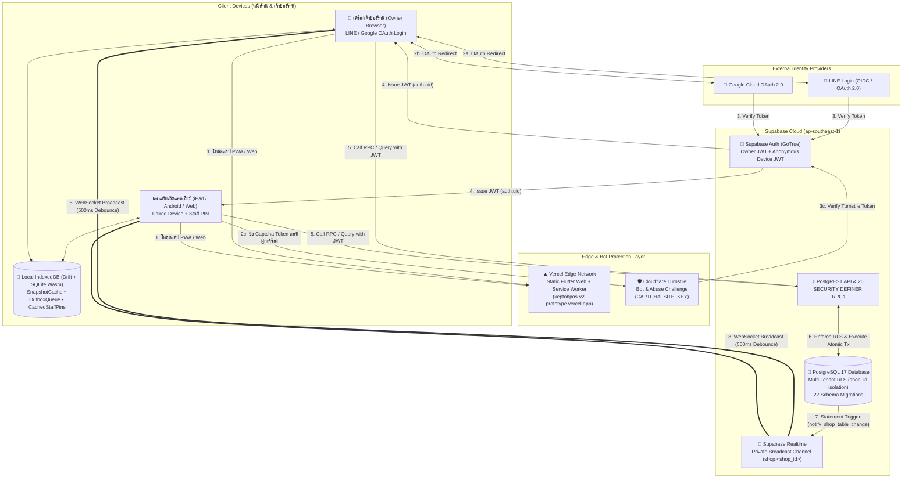
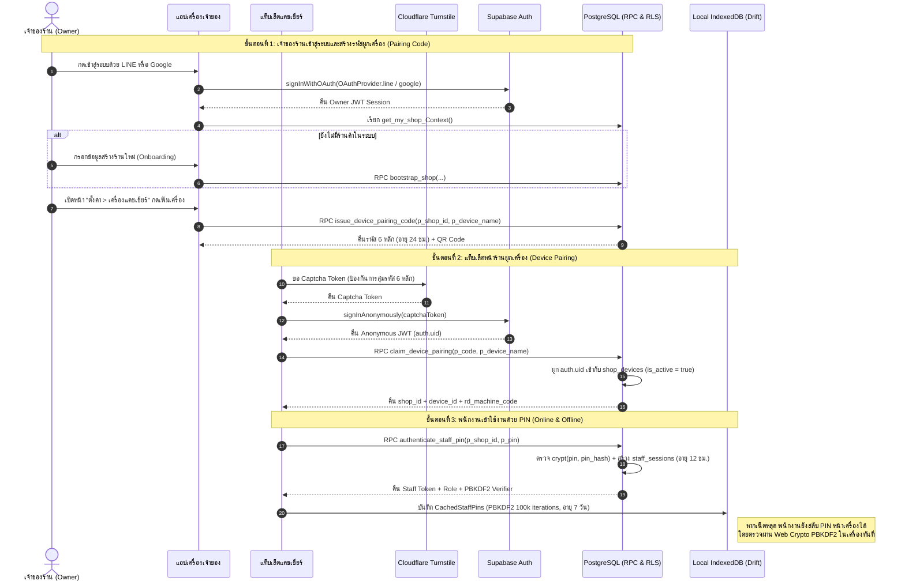
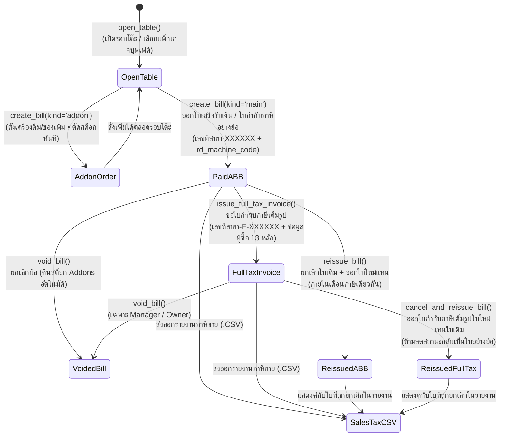

# เก็บโต๊ะ POS (KepToh POS V2)

> **ระบบจัดการหน้าร้าน สต็อก และกำไรรายวันสำหรับร้านหมูกระทะบุฟเฟต์และร้านอาหาร (Multi-Tenant, Offline-First, Thai RD Tax Compliant)**

[](https://flutter.dev)
[](https://supabase.com)
[](https://keptohpos-v2-prototype.vercel.app)
[](https://www.cloudflare.com/products/turnstile/)

**เก็บโต๊ะ POS (KepToh POS V2)** คือระบบ Point of Sale (POS) แบบ Cloud SaaS (Multi-Tenant) ที่ออกแบบมาเพื่อแก้ปัญหาหลักของร้านหมูกระทะบุฟเฟต์และร้านอาหารในไทยโดยเฉพาะ: **"คีย์ข้อมูลให้น้อยที่สุด ขายต่อได้แม้เน็ตหลุด ซิงก์หลายเครื่องแบบเรียลไทม์ ออกใบกำกับภาษีถูกต้องตามหลักกรมสรรพากร และรู้ทันทีว่าวันนี้ร้านกำไรหรือขาดทุนเท่าไหร่"**

- **Production URL:** https://keptohpos-v2-prototype.vercel.app (และ https://keptoh-staging.vercel.app)
- **คู่มือสำหรับนักพัฒนาฝั่ง Flutter App:** [`app/README.md`](app/README.md)
- **เอกสาร Blueprint & กฎธุรกิจ:** [`docs/llms/keptoh-blueprint.md`](docs/llms/keptoh-blueprint.md)
- **ตารางผลการทดสอบระบบ (Test Matrix):** [`docs/test_matrix.md`](docs/test_matrix.md)

---

## สารบัญ (Table of Contents)

1. [ขอบเขตความสามารถของระบบ (Product Specification)](#1-ขอบเขตความสามารถของระบบ-product-specification)
2. [กฎธุรกิจและการคำนวณทางการเงิน (Business & Financial Spec)](#2-กฎธุรกิจและการคำนวณทางการเงิน-business--financial-spec)
3. [สถาปัตยกรรมระบบและแผนภาพการไหลของข้อมูล (System Architecture & Data Flow Diagrams)](#3-สถาปัตยกรรมระบบและแผนภาพการไหลของข้อมูล-system-architecture--data-flow-diagrams)
4. [เทคโนโลยีและเครื่องมือที่ใช้ (Tech Stack & Tooling)](#4-เทคโนโลยีและเครื่องมือที่ใช้-tech-stack--tooling)
5. [โครงสร้างการ Deploy และบริการภายนอก (Vercel, Cloudflare, Supabase, OAuth)](#5-โครงสร้างการ-deploy-และบริการภายนอก-vercel-cloudflare-supabase-oauth)
6. [โครงสร้างโปรเจกต์ (Repository Structure)](#6-โครงสร้างโปรเจกต์-repository-structure)
7. [การติดตั้งและรันระบบในเครื่อง (Local Development & Testing)](#7-การติดตั้งและรันระบบในเครื่อง-local-development--testing)

---

## 1. ขอบเขตความสามารถของระบบ (Product Specification)

### 1.1 โมดูลการทำงานหลัก 7 ส่วน

| โมดูล | ความสามารถหลัก (Core Capabilities) |
| :--- | :--- |
| **1. โต๊ะและการขาย (`Tables & POS`)** | • เปิดโต๊ะ เลือกแพ็กเกจบุฟเฟต์ แยกราคา **ผู้ใหญ่ / เด็ก / เด็กเล็กทานฟรี**<br>• รองรับทั้งร้านแบบ **จ่ายก่อนกิน (`Pay-now`)** และ **กินก่อนจ่าย (`Pay-later`)**<br>• สั่งรายการขายเสริม (`Addons`: น้ำ น้ำแข็ง เบียร์ ชีส) แยกบิลและตัดสต็อกอัตโนมัติ<br>• **ย้ายโต๊ะ (`move_table`)** และ **รวมโต๊ะ (`merge_tables`)** พร้อมระบบผูก `table_session_aliases` ป้องกันข้อมูลชนกันเมื่อสั่งอาหารขณะออฟไลน์<br>• จับเวลาตามแพ็กเกจ และรองรับการชำระด้วย **เงินสด / QR PromptPay / โอนเงิน** |
| **2. บิลและใบกำกับภาษี (`Bills & Thai RD VAT`)** | • รองรับ 3 โหมดภาษี: **ไม่จด VAT (`none`)**, **VAT 7% รวมในราคา (`included`)**, **VAT 7% แยกนอกราคา (`excluded`)**<br>• **ใบกำกับภาษีอย่างย่อ (`Abbreviated Tax Invoice`):** แสดงเลขผู้เสียภาษี 13 หลัก, รหัสสาขา 5 หลัก (`00000`), รหัสเครื่องบันทึกการเก็บเงินกรมสรรพากร (`rd_machine_code`), คำเตือน `"เอกสารออกเป็นชุด"`, และข้อความ `"รวมภาษีมูลค่าเพิ่มแล้ว"`<br>• **ใบกำกับภาษีเต็มรูป (`Full Tax Invoice`):** ออกเลขลำดับแยกชุด (`<branch>-F-xxxxxx`) พร้อมบันทึกชื่อ/บริษัท เลขผู้เสียภาษี สาขา และที่อยู่ผู้ซื้อ<br>• **ยกเลิกบิล (`Void`) และออกบิลใหม่แทนใบเดิม (`Reissue`):** คืนสต็อก `Addons` อัตโนมัติ, อ้างอิงเลขบิลเดิม (`replaces_bill_id`), จำกัดเฉพาะภายในเดือนภาษีเดียวกัน (`Asia/Bangkok`) และมี Guard ป้องกันการลดสถานะใบกำกับภาษีเต็มรูปกลับเป็นใบอย่างย่อ |
| **3. สต็อกและวัตถุดิบ (`Stock & Ingredients`)** | • **นับของเหลือปิดร้าน (`Closing Stock Count`):** พนักงานชั่ง/นับเฉพาะของที่เหลือตอนปิดร้าน ระบบคำนวณวัตถุดิบที่ใช้ไปเองโดยไม่ต้องคีย์เบิกทีละจาน<br>• **รับของเข้า (`Stock Purchase`):** มีปุ่ม **"คัดลอกรายการเดิมจากครั้งก่อน"** เพื่อลดเวลาคีย์ข้อมูลของสดประจำวัน<br>• **สถานะสต็อกอัจฉริยะ:** แยกสถานะ `พอ` / `ใกล้หมด` / `หมด` เทียบกับจุดสั่งซื้อ (`Par Level`) พร้อมคำนวณจำนวนที่ต้องซื้อเพิ่มให้อัตโนมัติ |
| **4. กะและลิ้นชักเงินสด (`Shifts & Expenses`)** | • เปิดกะพร้อมระบุเงินทอนตั้งต้น (`Opening Cash`)<br>• บันทึกรายจ่ายหน้าร้านรายวัน (`Daily Expenses` เช่น ค่าน้ำแข็ง ค่าแก๊ส)<br>• ปิดกะพร้อมกระทบยอดเงินสดที่นับได้จริงเทียบกับยอดที่ควรมีในระบบ (`Expected vs Actual Cash`) |
| **5. ภาพรวมผู้บริหาร (`Executive P&L Dashboard`)** | • แสดง **กำไรขั้นต้น (`Gross Profit`)**, **กำไรสุทธิโดยประมาณ (`Net Profit`)**, **ต้นทุนต่อหัว (`Cost/Head`)**, และ **สัดส่วนต้นทุนอาหาร (`% Food Cost`)** เทียบเกณฑ์มาตรฐาน (30–35%)<br>• กราฟแนวโน้มกำไรรายวัน สัดส่วนต้นทุนแยกตามวัตถุดิบ และยอดขายเสริม |
| **6. รายงานและภาษีขาย (`Reports & Tax CSV`)** | • ตารางสรุปผลประกอบการรายวันประจำเดือน<br>• **รายงานภาษีขาย (`Sales Tax Report`)** แสดงเลขที่ใบกำกับภาษี ชื่อผู้ซื้อ เลขผู้เสียภาษี สถานะยกเลิก/ออกแทน ยอดก่อนภาษี และภาษีมูลค่าเพิ่ม<br>• **สรุปยอดขายรายวันแยกตามเครื่อง (`Daily Per-Device Summary`)** แยกตาม `rd_machine_code`<br>• ส่งออกไฟล์ **`.csv` (UTF-8 with BOM)** เปิดใน Microsoft Excel ภาษาไทยได้ทันทีสำหรับส่งสำนักงานบัญชี |
| **7. ตั้งค่าและสิทธิ์การใช้งาน (`Settings & RBAC`)** | • จัดการข้อมูลร้าน แพ็กเกจ ขายเสริม วัตถุดิบ แหล่งซื้อ โต๊ะ พนักงาน และช่องทางชำระเงิน<br>• **ผูกเครื่องแคชเชียร์ (`Device Pairing`):** สร้างรหัสผูกเครื่อง 6 หลัก (อายุ 24 ชั่วโมง) สำหรับแท็บเล็ตหน้าร้านโดยไม่ต้องใช้รหัสผ่านเจ้าของร้าน |

### 1.2 ระบบสิทธิ์ผู้ใช้งาน (Role-Based Access Control)

| บทบาท (`Role`) | โต๊ะ / ขาย / สต็อก / กะ | ยกเลิกบิล (`Void`) | ออกบิลใหม่แทนใบเดิม (`Reissue`) | ดูต้นทุน / กำไร (`can_view_costs`) | ภาพรวม / รายงาน / ตั้งค่าระบบ |
| :--- | :---: | :---: | :---: | :---: | :---: |
| **แคชเชียร์ (`cashier`)** | ✅ (เพิ่มรายการรับของ/รายจ่ายได้) | เฉพาะโต๊ะที่ยังเปิดอยู่ (`closed_at IS NULL`) | ❌ | ตามสิทธิ์รายบุคคล (`can_view_costs`) | ❌ |
| **ผู้จัดการ (`manager`)** | ✅ (แก้ไข/ลบ/ยกเลิกปิดวันได้) | ✅ ทุกบิล (ระบุเหตุผล) | ✅ (ภายในเดือนภาษีเดียวกัน) | ✅ | ✅ |
| **เจ้าของร้าน (`owner`)** | ✅ ทุกส่วน | ✅ ทุกบิล | ✅ (ภายในเดือนภาษีเดียวกัน) | ✅ | ✅ + จัดการผูกเครื่อง (`Device Pairing`) |

---

## 2. กฎธุรกิจและการคำนวณทางการเงิน (Business & Financial Spec)

1. **หน่วยเงินและการคำนวณภาษีแบบไร้ทศนิยมคลาดเคลื่อน (`BIGINT Satang & Basis Points`):**
   - จำนวนเงินทั้งหมดในฐานข้อมูลจัดเก็บเป็นหน่วย **สตางค์ (`BIGINT`, `100 = 1.00 บาท`)** และอัตราภาษีเก็บเป็น **Basis Points (`700 = 7.00%`)**
   - ไม่ใช้ `FLOAT` หรือ `DOUBLE PRECISION` ในการคำนวณเงิน และใช้การปัดเศษแบบ **Integer Half-Up Rounding** ใน PostgreSQL RPC ทุกจุด:
     $$\text{VAT (Excluded)} = \left\lfloor \frac{\text{Net} \times \text{vat\_rate} + 5000}{10000} \right\rfloor$$
     $$\text{VAT (Included)} = \left\lfloor \frac{\text{Gross} \times \text{vat\_rate} + \lfloor (10000 + \text{vat\_rate}) / 2 \rfloor}{10000 + \text{vat\_rate}} \right\rfloor$$
2. **สูตรคำนวณต้นทุนและกำไรรายวัน (`Daily P&L Formulas`):**
   - **ปริมาณวัตถุดิบที่ใช้จริง:** $\text{Used} = \text{Opening Stock} + \text{Purchases} - \text{Closing Count}$
   - **มูลค่าต้นทุนต่อหน่วย:** รองรับทั้ง **ต้นทุนเฉลี่ยถ่วงน้ำหนัก (`Weighted Average Cost`)** และ **ราคาซื้อล่าสุด (`Last Purchase Cost`)**
   - **กำไรขั้นต้น (`Gross Profit`):** $\text{Sales (Excl. VAT)} - \text{Buffet Ingredient Cost} - \text{Beverage/Addon Cost}$
   - **กำไรสุทธิโดยประมาณ (`Estimated Net Profit`):** $\text{Gross Profit} - \text{Daily Expenses} - \frac{\text{Monthly Fixed Costs}}{\text{Operating Days}}$
   - **ต้นทุนวัตถุดิบต่อหัว (`Cost per Head`):** $\frac{\text{Buffet Ingredient Cost}}{\text{Adults} + (\text{Children} \times \text{Child Weight})}$

---

## 3. สถาปัตยกรรมระบบและแผนภาพการไหลของข้อมูล (System Architecture & Data Flow Diagrams)

### 3.1 แผนภาพโครงสร้างพื้นฐานและการเชื่อมต่อบริการ (Infrastructure & Deployment Topology)



---

### 3.2 แผนภาพการยืนยันตัวตน 2 รูปแบบ และการผูกเครื่องแคชเชียร์ (Dual-Session Auth & Device Pairing Flow)

ระบบแยกการยืนยันตัวตนออกเป็น **เครื่องเจ้าของร้าน (`Owner Session`)** และ **เครื่องแท็บเล็ตหน้าร้าน (`Paired Device Session`)** เพื่อให้แท็บเล็ตแคชเชียร์ใช้งานได้ต่อเนื่องโดยไม่ต้องทราบรหัสผ่าน LINE/Google ของเจ้าของร้าน และสลับพนักงานด้วยรหัส PIN 4–6 หลักได้แม้ขณะอินเทอร์เน็ตหลุด:



---

### 3.3 แผนภาพการทำงานแบบ Offline-First และการซิงก์ข้อมูลหลายเครื่องแบบเรียลไทม์ (Offline Outbox & Multi-Device Realtime Data Flow)

```mermaid
flowchart LR
    subgraph TabletA["แท็บเล็ตเครื่องที่ 1 (Cashier A)"]
        UI_A["Flutter BLoC / UI"]
        Cache_A[("SnapshotCache<br/>(IndexedDB)")]
        Outbox_A[("OutboxQueue<br/>(FIFO Mutations)")]
        Sync_A["OutboxSyncService"]
    end

    subgraph Backend["Supabase PostgreSQL 17"]
        RPC["SECURITY DEFINER RPCs<br/>(open_table, create_bill,<br/>merge_tables, void_bill, ...)"]
        AliasTable[("table_session_aliases<br/>(Secondary ➔ Primary Map)")]
        Tables[("Core POS Tables<br/>(bills, table_sessions,<br/>ingredients, shifts, ...)")]
        Trigger["Statement Trigger<br/>notify_shop_table_change()"]
        Channel["Realtime Broadcast<br/>Topic: shop:&lt;shop_id&gt;"]
    end

    subgraph TabletB["แท็บเล็ตเครื่องที่ 2 / มือถือเจ้าของ"]
        RT_B["ShopRealtimeService<br/>(500ms Debounce)"]
        UI_B["PosBlocQuietReloadRequested<br/>(อัปเดตหน้าจอโดยไม่กระพริบ)"]
    end

    UI_A -->|"1. กดเปิดโต๊ะ / คิดเงิน / นับสต็อก"| Cache_A
    UI_A -->|"2. บันทึกคำสั่งลงคิวทันที<br/>(ทำงานต่อได้แม้ Offline)"| Outbox_A
    Outbox_A -->|"3. เมื่อ Online: ส่งตามลำดับ FIFO"| Sync_A
    Sync_A -->|"4. เรียก PostgreSQL RPC"| RPC
    RPC <-->|"5a. หากโต๊ะถูกรวมไปแล้ว<br/>แปลง Secondary ID ➔ Primary ID"| AliasTable
    RPC -->|"5b. Commit ธุรกรรมแบบ Atomic"| Tables
    Tables -->|"6. AFTER INSERT/UPDATE/DELETE"| Trigger
    Trigger -->|"7. realtime.send(payload)"| Channel
    Channel ==>|"8. WebSocket Event"| RT_B
    RT_B -->|"9. รอรวม Event 500ms<br/>แล้วดึง Snapshot ล่าสุด"| UI_B
```



**กลไกสำคัญของระบบ Offline-First & Sync:**
- **ไม่บล็อกพนักงานหน้าร้าน:** ทุกการกดเปิดโต๊ะ สั่งอาหาร หรือคิดเงิน จะอัปเดต `SnapshotCache` และบันทึกเข้า `OutboxQueue` บน `IndexedDB` ทันที พร้อมแสดงป้ายเตือนจำนวนรายการรอซิงก์ (`Pending Sync Banner`) เมื่ออินเทอร์เน็ตหลุด
- **การแก้ปัญหาข้อมูลชนกันเมื่อรวมโต๊ะขณะออฟไลน์ (`Merged Table Alias Resolution`):** หากเครื่องที่ 1 ออฟไลน์แล้วสั่งอาหารเข้าโต๊ะ `T2` ในขณะที่เครื่องที่ 2 รวมโต๊ะ `T2` เข้ากับ `T1` ไปแล้ว ตาราง `table_session_aliases` และฟังก์ชัน `resolve_table_session_id()` ในฐานข้อมูลจะโอนรายการอาหารจาก `T2` เข้าสู่บิลหลักของ `T1` ให้อัตโนมัติเมื่อเครื่องที่ 1 กลับมาออนไลน์
- **Realtime Broadcast แบบประหยัดโควต้า:** ใช้ `AFTER INSERT OR UPDATE OR DELETE ... FOR EACH STATEMENT` Trigger ส่งสัญญาณเข้า Private Channel `shop:<shop_id>` และฝั่ง Flutter มีตัวหน่วงเวลา **500ms Debounce** เพื่อรวบหลายการเปลี่ยนแปลงในคราวเดียวก่อนสั่ง `PosBlocQuietReloadRequested`

---

### 3.4 แผนภาพวงจรชีวิตบิลและใบกำกับภาษีกรมสรรพากร (Billing & Thai RD Tax Lifecycle)



---

## 4. เทคโนโลยีและเครื่องมือที่ใช้ (Tech Stack & Tooling)

| หมวดหมู่ (Layer) | เทคโนโลยี / เครื่องมือ | บทบาทหน้าที่ในโปรเจกต์ |
| :--- | :--- | :--- |
| **Frontend Framework** | **Flutter Web (`3.47.9`) / Dart (`^3.13.7`)** | พัฒนา UI แบบ Cross-platform (รองรับ iPad, Android Tablet, Desktop Browser) เรนเดอร์ด้วย CanvasKit พร้อมฟอนต์ไทย `Anuphan` และ `IBM Plex Sans Thai` |
| **State Management & DI** | **`flutter_bloc` (`^9.1.1`) + `get_it` (`^9.3.0`)** | จัดการสถานะหน้าจอแบบแยก Event/State ชัดเจน (`PosBloc`, `BillsBloc`, `StockBloc`, `ShiftBloc`, `SettingsBloc`, `OnboardingCubit`) |
| **Routing & Icons** | **`go_router` (`^18.1.2`) + `hugeicons` (`^0.0.7`) + `qr_flutter`** | จัดการ URL Routing, Route Guard ตรวจสอบสิทธิ์ และสร้าง QR Code สำหรับผูกเครื่อง/PromptPay |
| **Offline Database (Client)** | **`drift` (`^2.35.3`) + `drift_flutter` + `sqlite3.wasm`** | ฐานข้อมูล SQLite บน WebAssembly (`IndexedDB`) เก็บ `SnapshotCache`, `OutboxQueue`, และ `CachedStaffPins` พร้อม Custom Service Worker (`build_sw.sh`) |
| **Backend & Database** | **Supabase PostgreSQL 17** | ฐานข้อมูลหลักแบบ Multi-tenant บังคับใช้ **Row-Level Security (RLS)** ทุกตาราง และประมวลผลธุรกรรมผ่าน **26 `SECURITY DEFINER` RPCs** |
| **Realtime Sync** | **Supabase Realtime (Broadcast)** | ส่งสัญญาณแจ้งเตือนการเปลี่ยนแปลงข้อมูลภายในร้านผ่าน Private Channel `shop:<shop_id>` |
| **Authentication** | **Supabase Auth (`LINE OIDC`, `Google OAuth`, `Anonymous Auth`)** | ยืนยันตัวตนเจ้าของร้านผ่าน LINE / Google และสร้าง Anonymous Session สำหรับแท็บเล็ตแคชเชียร์ที่ผูกเครื่อง |
| **Security & Bot Protection** | **Cloudflare Turnstile + Web Crypto `PBKDF2`** | ป้องกันบอทยิงสุ่มรหัสผูกเครื่องด้วย Turnstile Captcha และเข้ารหัสรหัส PIN พนักงานแบบออฟไลน์ด้วย `PBKDF2-HMAC-SHA256` (100,000 รอบ) |
| **Hosting & Edge CDN** | **Vercel** | Build และให้บริการไฟล์ Static ของ Flutter Web ผ่าน Global Edge Network |
| **Automated Testing (5 Layers)** | **`flutter test`, `pgTAP`, `flutter drive`, `Playwright`** | ชุดทดสอบอัตโนมัติ 5 ชั้น รวม **694 Tests** (Unit, BLoC, Widget, Golden Visual Regression, SQL pgTAP, Supabase Integration, และ Browser E2E) |

---

## 5. โครงสร้างการ Deploy และบริการภายนอก (Vercel, Cloudflare, Supabase, OAuth)

ระบบ Production ทำงานร่วมกันระหว่าง 5 บริการหลัก โดยมีรายละเอียดการตั้งค่าดังนี้:

### 5.1 Vercel (Frontend Hosting & Automated Build Pipeline)
- **ไฟล์กำหนดค่า:** [`vercel.json`](vercel.json), [`scripts/vercel-build.sh`](scripts/vercel-build.sh), และ [`app/scripts/vercel-build.sh`](app/scripts/vercel-build.sh)
- **ขั้นตอนการ Build บน Vercel:**
  1. ติดตั้ง Flutter SDK (`stable`) บนเครื่อง Build ของ Vercel อัตโนมัติหากยังไม่มี
  2. ดึงแพ็กเกจด้วย `flutter pub get`
  3. อ่านค่า Environment Variables จาก Vercel แล้วฉีดเข้าคอมไพเลอร์ด้วย `--dart-define`
  4. รัน `flutter build web --release` สร้างไฟล์ลงที่ `app/build/web`
  5. รัน [`app/scripts/build_sw.sh`](app/scripts/build_sw.sh) เพื่อสร้าง Service Worker สำหรับแคชไฟล์แอป (`sqlite3.wasm`, `drift_worker.js`, ฟอนต์ และ Assets) ให้เปิดหน้าเว็บได้แม้ไม่มีอินเทอร์เน็ต
- **Environment Variables ที่ต้องตั้งบน Vercel (สำหรับ `Production` และ `Preview`):**

| ตัวแปร (Variable) | ตัวอย่างค่า / คำอธิบาย |
| :--- | :--- |
| `POS_BACKEND` | `supabase` (หากไม่กำหนด แอปจะรันในโหมด `mock` สำหรับสาธิต) |
| `SUPABASE_URL` | `https://<project-ref>.supabase.co` (URL ของโปรเจกต์ Supabase) |
| `SUPABASE_ANON_KEY` | Public Anon Key ของโปรเจกต์ Supabase (ปลอดภัยภายใต้ RLS) |
| `CAPTCHA_SITE_KEY` | Public Site Key ของ **Cloudflare Turnstile** (หากเว้นว่างจะปิดการขอ Captcha สำหรับ Local Dev) |

### 5.2 Cloudflare Turnstile (Edge Bot & Abuse Protection)
- **หน้าที่:** ป้องกันการโจมตีแบบ Brute-force สุ่มรหัสผูกเครื่อง 6 หลัก (`claim_device_pairing`) และการปั๊ม Anonymous Users ใน Supabase Auth
- **จุดที่เชื่อมต่อ:**
  1. **ฝั่ง Cloudflare Dashboard:** สร้าง Turnstile Widget (โหมด Managed / Invisible) และเพิ่มโดเมน Production (`keptohpos-v2-prototype.vercel.app`, `keptoh-staging.vercel.app`) ในรายการ Hostnames
  2. **ฝั่ง Vercel:** นำ **Site Key** มาตั้งในตัวแปร `CAPTCHA_SITE_KEY` (โค้ดฝั่งเว็บอยู่ใน [`app/lib/core/supabase/turnstile_token_web.dart`](app/lib/core/supabase/turnstile_token_web.dart))
  3. **ฝั่ง Supabase Auth:** นำ **Secret Key** ของ Turnstile ไปเปิดใช้งานในเมนู `Supabase Dashboard > Authentication > Bot and Abuse Protection (Enable Captcha protection -> Cloudflare Turnstile)`

### 5.3 Supabase (PostgreSQL 17, Auth, RLS & Realtime)
- **โครงสร้างฐานข้อมูล (`supabase/migrations/`):**
  - ประกอบด้วย **22 ไฟล์ Migration** ตามลำดับเวลา ตั้งแต่การสร้างตารางหลัก, นโยบาย RLS, ฟังก์ชัน RPC, ระบบผูกเครื่อง, ใบกำกับภาษีกรมสรรพากร, ไปจนถึง `table_session_aliases`
- **การตั้งค่า Authentication Providers บน Supabase:**
  - **Anonymous Sign-Ins:** เปิดใช้งาน (`Enable Anonymous Sign-Ins = true`) เพื่อให้แท็บเล็ตหน้าร้านสามารถรับ JWT เฉพาะเครื่องได้ตอนกดผูกเครื่อง
  - **Redirect URLs (`URL Configuration`):** กำหนด Site URL เป็น `https://keptohpos-v2-prototype.vercel.app` และเพิ่ม `https://keptohpos-v2-prototype.vercel.app/**`, `https://keptoh-staging.vercel.app/**`, `http://localhost:3000/**` ใน Redirect URLs

### 5.4 LINE Login & Google Cloud OAuth (สำหรับเจ้าของร้าน)
- **LINE Developers Console:**
  - สร้าง LINE Login Channel และนำ `Channel ID` / `Channel Secret` ไปผูกใน Supabase Auth (`LINE` / Keycloak OIDC Provider)
  - ตั้งค่า Callback URL ใน LINE Console ชี้ไปที่ `https://<project-ref>.supabase.co/auth/v1/callback`
- **Google Cloud Console:**
  - สร้าง OAuth 2.0 Client ID (Web Application) กำหนด Authorized Redirect URI ไปที่ `https://<project-ref>.supabase.co/auth/v1/callback` และนำ Client ID / Secret ไปผูกใน Supabase Auth (`Google Provider`)

### 5.5 GitHub Actions CI/CD (`.github/workflows/ci.yml`)
ทุกครั้งที่มีการเปิด Pull Request หรือ Push เข้ากิ่ง `main` ระบบจะรัน 2 Jobs คู่ขนานโดยอัตโนมัติ:
1. **`Flutter analyze and tests`:** ตรวจ Static Analysis (`flutter analyze lib test`) และรัน Unit, BLoC, Widget tests
2. **`Database and integration tests`:** สตาร์ท Local Supabase Docker บน GitHub Runner, รัน `supabase test db` (pgTAP), `supabase db lint`, รัน Dart Integration Tests เชื่อมฐานข้อมูลจริง และรัน Browser E2E (`scripts/e2e.sh`)

---

## 6. โครงสร้างโปรเจกต์ (Repository Structure)

```text
KepTohPOS-V2/
├── app/                                # โค้ดแอปพลิเคชัน Flutter Web / Tablet
│   ├── lib/
│   │   ├── core/                       # โครงสร้างกลาง (DI, Router, Theme, Offline Outbox, Supabase Client, Utils)
│   │   ├── data/                       # Data Layer (Models, Repositories, Mock & Supabase Data Sources)
│   │   ├── features/                   # แยกตามฟีเจอร์ (pos, bills, stock, shift, dashboard, reports, settings, onboarding)
│   │   └── shared/                     # Shared UI Components & Formatters (Confirm, FormModal, NumPad, TaxIdBranchInput)
│   ├── scripts/
│   │   ├── vercel-build.sh             # สคริปต์ Build สำหรับ Vercel พร้อมฉีด --dart-define
│   │   └── build_sw.sh                 # สคริปต์สร้าง Offline Service Worker
│   ├── test/                           # ชุดทดสอบฝั่ง Flutter (unit/, bloc/, widget/, golden/, integration/)
│   ├── integration_test/               # ชุดทดสอบ Browser E2E (flutter drive)
│   └── web/                            # ไฟล์ HTML/Manifest, sqlite3.wasm, drift_worker.js และหน้า Boot Loader
├── supabase/                           # โครงสร้างฐานข้อมูลและการตั้งค่า Supabase
│   ├── config.toml                     # ตั้งค่า Local Supabase Docker
│   ├── migrations/                     # ไฟล์ SQL Migrations ทั้งหมด 22 ไฟล์
│   ├── seed.sql                        # ข้อมูลตั้งต้นสำหรับทดสอบในเครื่อง
│   └── tests/                          # ชุดทดสอบฐานข้อมูล pgTAP (rls_and_rpcs_test.sql)
├── scripts/
│   ├── vercel-build.sh                 # Wrapper เรียก app/scripts/vercel-build.sh จาก Root
│   └── e2e.sh                          # สคริปต์รันการทดสอบ End-to-End บน Chrome WebDriver
├── docs/                               # เอกสารสถาปัตยกรรมและผลการทดสอบ
│   ├── llms/keptoh-blueprint.md        # เอกสารกฎธุรกิจและสูตรคำนวณหลัก
│   └── test_matrix.md                  # ตารางผลการทดสอบครบทุกโมดูล
└── vercel.json                         # ตั้งค่าการ Build และ SPA Rewrites บน Vercel
```

---

## 7. การติดตั้งและรันระบบในเครื่อง (Local Development & Testing)

### 7.1 สิ่งที่ต้องติดตั้งล่วงหน้า (Prerequisites)
- **Flutter SDK:** เวอร์ชัน `3.47.x` (Channel `stable`) และเปิดใช้งาน Web (`flutter config --enable-web`)
- **Supabase CLI:** เวอร์ชัน `2.121.0+` และ **Docker Desktop** (สำหรับการรันฐานข้อมูล Supabase ในเครื่อง)

### 7.2 การรันแอปเพื่อพัฒนาในเครื่อง (Local Run)

**วิธีที่ 1: รันโหมด Mock Data (ไม่ต้องเปิด Docker)**
```bash
cd app
flutter pub get
flutter run -d chrome --web-port 3000
```

**วิธีที่ 2: รันเชื่อมต่อ Local Supabase Docker เต็มรูปแบบ**
```bash
# 1. สตาร์ท Supabase บน Docker (รันจาก Root ของโปรเจกต์)
supabase start
supabase db reset

# 2. ดึงค่า API_URL และ ANON_KEY จากสถานะของ Supabase แล้วรันแอป
cd app
eval "$(supabase status -o env | grep -E '^(API_URL|ANON_KEY)=')"
flutter run -d chrome --web-port 3000 \
  --dart-define=POS_BACKEND=supabase \
  --dart-define=SUPABASE_URL="$API_URL" \
  --dart-define=SUPABASE_ANON_KEY="$ANON_KEY"
```

### 7.3 คำสั่งรันชุดทดสอบทั้ง 5 ชั้น (Verification Commands)

```bash
# 1. ตรวจคุณภาพโค้ดและ Typecheck ฝั่ง Flutter
cd app && flutter analyze lib test

# 2. รัน Unit, BLoC, Widget และ Golden Tests (650 Tests)
cd app && flutter test test/unit test/bloc test/widget test/golden

# 3. รันชุดทดสอบฐานข้อมูล SQL pgTAP (ต้องเปิด supabase start ก่อน)
supabase test db
supabase db lint --level warning --fail-on error

# 4. รันชุดทดสอบ Integration Tests เชื่อมต่อ Local Supabase จริง (38 Tests)
cd app
eval "$(supabase status -o env | grep -E '^(API_URL|ANON_KEY)=')"
SUPABASE_TEST_URL="$API_URL" SUPABASE_TEST_ANON_KEY="$ANON_KEY" \
  flutter test test/integration

# 5. รันชุดทดสอบ Browser End-to-End (E2E)
bash scripts/e2e.sh
```
