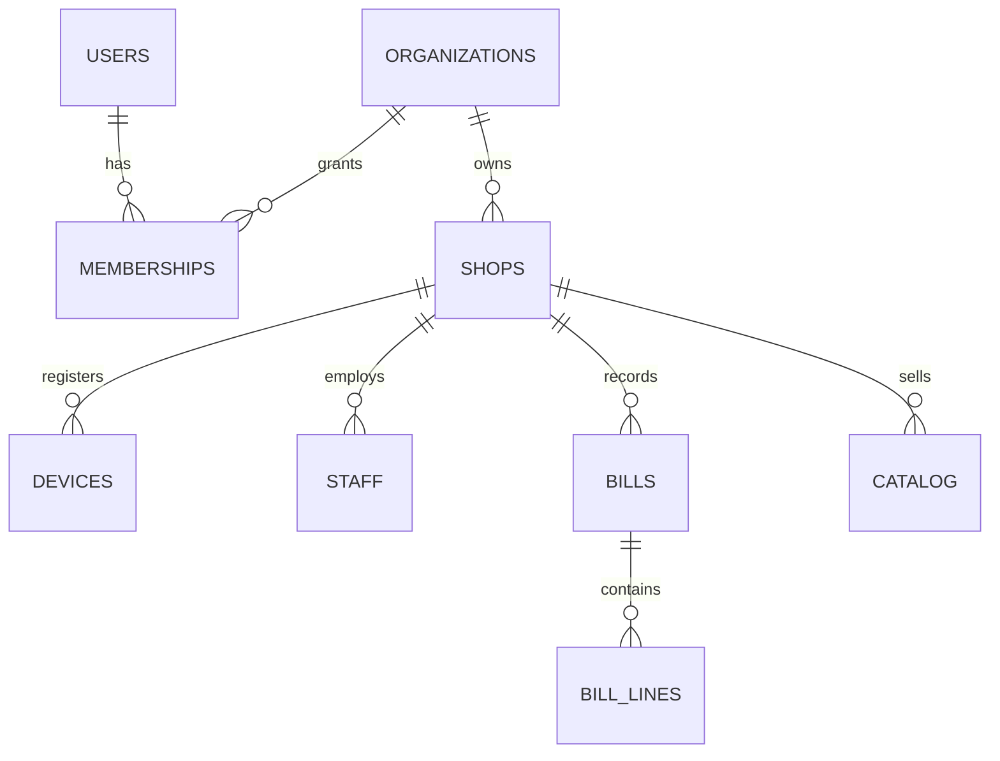
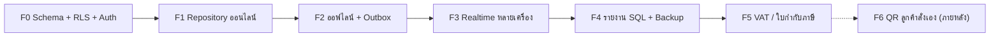

# แผน Backend — KepToh POS (ร่างเพื่อคุยกัน)

**ข้อกำหนดที่ยืนยันแล้ว:** ขายต่อได้ตอนออฟไลน์แล้ว sync ทีหลัง · รองรับทั้งร้านที่จดและไม่จด VAT · Database และ Backend stack ใช้แผนฟรี · ใช้ได้ทั้งเว็บและแอป · ตอนนี้มีแต่ร้านเล็กสาขาเดียว (โครงสร้างหลายสาขาเผื่อไว้สำหรับอนาคต)

> [!NOTE]
> ตัวเลขโควตาแผนฟรีในเอกสารนี้มาจากความรู้ที่ผมมีอยู่ ต้องเช็กหน้า pricing ล่าสุดของแต่ละบริการก่อนเริ่มทำ

---

## 1. Stack ที่เสนอ (ฟรีทั้งหมด)

| ส่วน | เลือก | หน้าที่ |
| :--- | :--- | :--- |
| Database + Auth + Realtime | **Supabase (Free)** | Postgres, ล็อกอินเจ้าของ/ผู้จัดการ, RLS แยกข้อมูลรายร้าน, Realtime ให้หลายเครื่องเห็นโต๊ะตรงกัน |
| Logic ฝั่งเซิร์ฟเวอร์ | **Postgres functions (RPC, plpgsql)** | บันทึกบิล/ยกเลิก/ปิดกะ/ปิดยอด แบบ atomic และตรวจยอดซ้ำ ใช้ Edge Functions เฉพาะงานที่ต้องเรียกบริการภายนอก |
| ฐานข้อมูลในเครื่อง (ออฟไลน์) | **Drift (SQLite)** | ใช้ได้ทั้ง Android/iOS และเว็บ (WASM) แทน `localStorage` ปัจจุบัน |
| Sync | **Outbox ที่เขียนเอง** (ทางเลือก: PowerSync free tier) | คิวรายการรอส่ง + ส่งซ้ำได้โดยไม่บันทึกซ้ำ (idempotent) |
| Hosting เว็บ | Vercel (ใช้อยู่แล้ว) | — |
| สำรองข้อมูล | **GitHub Actions รัน `pg_dump` ทุกคืน** → Cloudflare R2 / private repo | ชดเชยที่แผนฟรีของ Supabase ไม่มีสำรองข้อมูลอัตโนมัติ |

**ทำไมใช้ Outbox เขียนเอง:** ข้อมูล POS ส่วนใหญ่เป็นแบบ "เพิ่มอย่างเดียว" (บิล, รอบสั่ง, การนับสต็อก, ค่าใช้จ่าย) โอกาสข้อมูลชนกันจึงต่ำ และไม่ต้องผูกกับโควตาฟรีของบริการภายนอก ส่วนข้อมูลตั้งค่า (เมนู, ราคา, พนักงาน) ให้แก้ได้ตอนออนไลน์เท่านั้น

---

## 2. โครงสร้างหลายร้าน / หลายสาขา

- **`organizations`** = กิจการตามกฎหมาย: `tax_id`, `vat_registered`, ชื่อจดทะเบียน
- **`shops`** = สาขา: `branch_code` (`00000` = สำนักงานใหญ่), ที่อยู่, การตั้งค่าร้าน (ตัดรอบวัน, วิธีหารค่าคงที่, VAT)
- **`memberships`** = ผู้ใช้ ↔ กิจการ/สาขา + บทบาท (owner/manager) เจ้าของ 1 คนมีได้หลายกิจการ
- **`devices`** = เครื่อง POS ที่ลงทะเบียนกับสาขา (ใช้ทั้งเรื่อง sync และเลขใบเสร็จ)
- **`staff`** = พนักงานรายสาขา (แคชเชียร์ใช้ PIN ที่เก็บแบบ hash ตรวจผ่าน RPC ไม่ต้องมีบัญชีอีเมล)
- **เมนู/ราคา/สต็อก/ค่าคงที่:** **แยกรายสาขา** (แนะนำสำหรับตอนนี้) ในอนาคตเพิ่มปุ่ม "คัดลอกเมนูจากสาขาอื่น" ได้โดยไม่ต้องแก้ schema
- **ทุกตารางธุรกรรมมี `shop_id`** + RLS policy: เห็นได้เฉพาะสาขาที่ตัวเองมี membership
- **รายงาน:** รายสาขา + รวมทั้งกิจการ (รวมได้เฉพาะสาขาในเลขผู้เสียภาษีเดียวกัน)

---

## 3. กติกาการคำนวณระดับ Production

1. **เงินเก็บเป็นจำนวนเต็ม "สตางค์" (`bigint`)** ทั้งในฐานข้อมูลและ Drift ต้องเปลี่ยน domain จาก `double`
2. **ID สร้างฝั่งเครื่อง (UUID v7)** การส่งซ้ำตอน sync จึงไม่ทำให้บิลซ้ำ
3. **เซิร์ฟเวอร์คำนวณยอดบิลซ้ำจากรายการ + สแนปช็อตราคา** ถ้ายอดไม่ตรงจะปฏิเสธและแจ้งเตือน (กันการแก้ยอด)
4. **บิลแก้ไขหรือลบไม่ได้** ยกเลิกได้อย่างเดียว พร้อมเหตุผล ผู้ทำ และเวลา บังคับด้วย trigger + `audit_log`
5. **เลขที่ใบเสร็จ: แยกชุดเลขต่อเครื่อง** (เช่น `00000-POS01-000123`) ออกเลขได้ตอนออฟไลน์และไม่ข้ามเลข
6. **วันทำการ:** ใช้ `Asia/Bangkok` + ตัดรอบ `day_cutoff_minutes` ทั้งใน Dart และ SQL
7. **Logic อยู่ 2 ที่ (Dart สำหรับออฟไลน์ + SQL ฝั่งเซิร์ฟเวอร์):** กันผลไม่ตรงกันด้วยชุดเคสทดสอบ JSON ชุดเดียวที่รันทั้ง `flutter test` และ SQL test (pgTAP)
8. **โต๊ะที่เปิดหลายเครื่องพร้อมกัน:** เก็บรอบสั่ง/การเพิ่มคนเป็น event แบบเพิ่มอย่างเดียว แล้วรวมผล จึงไม่เขียนทับกัน

> [!IMPORTANT]
> **ร้านที่จด VAT:** การออกใบกำกับภาษีอย่างย่อจากเครื่อง POS ต้องขออนุมัติกรมสรรพากรรายเครื่อง และแบบฟอร์ม/รูปแบบเลขต้องตรงตามที่ยื่น **ข้อนี้ต้องยืนยันกับทีมบัญชีก่อนทำเฟส 5** (`CIRCUIT_BREAKER: MISSING_SPEC`)

---

## 4. ลำดับการทำ (เฟส)

| เฟส | งาน | ผลที่ได้ |
| :--- | :--- | :--- |
| **F0** | Supabase project, migrations (organizations/shops/memberships/devices/staff/catalog/bills/shifts/stock), RLS, ล็อกอินเจ้าของ (อีเมล/Google), ลงทะเบียนเครื่อง + PIN พนักงาน | ฐานข้อมูลพร้อม และแยกข้อมูลรายร้านปลอดภัย |
| **F1** | `SupabasePosRepository` ที่ implement `PosRepository` เดิม + RPC `settle_bill`/`void_bill`/`close_shift` + เปลี่ยนเงินเป็นสตางค์ | แอปใช้ข้อมูลจริงตอนออนไลน์ (UI แทบไม่ต้องแก้) |
| **F2** | Drift + outbox + ตัว sync ที่ลองส่งซ้ำได้ + ป้ายสถานะ "รอ sync X รายการ" | ขายต่อได้ตอนเน็ตหลุด |
| **F3** | Supabase Realtime ให้สถานะโต๊ะ/รอบสั่งตรงกันทุกเครื่อง | แคชเชียร์ + แท็บเล็ตพนักงานเห็นตรงกัน |
| **F4** | Ledger/รายงานเป็น SQL view/RPC + GitHub Actions backup ทุกคืน + ทดสอบกู้คืนข้อมูล | รายงานเร็ว และกู้ข้อมูลได้ |
| **F5** | ใบกำกับภาษีอย่างย่อ/เต็มรูป, รหัสสาขา, รายงานภาษีขาย | รองรับร้านที่จด VAT |
| **F6** *(ภายหลัง: ยังไม่มีร้านที่ใช้)* | QR ประจำโต๊ะ → หน้าเว็บสาธารณะให้ลูกค้าสั่งเอง, token ผูกกับรอบเปิดโต๊ะ (หมดอายุเมื่อเก็บโต๊ะ), จำกัดความถี่การสั่ง, ออร์เดอร์รอแคชเชียร์/ครัวยืนยัน | ลดงานพนักงานช่วงร้านแน่น |

> [!WARNING]
> **ความเสี่ยงของแผนฟรี:** ไม่มีสำรองข้อมูลอัตโนมัติ (แก้ด้วย F4), โปรเจกต์ถูกพักเมื่อไม่มีการใช้งานราว 1 สัปดาห์, พื้นที่ DB ราว 500 MB (ร้านเล็กใช้ได้หลายปี เพราะบิลหนึ่งใบประมาณไม่กี่ KB) เมื่อมีร้านจ่ายเงินจริงควรพิจารณาแผน Pro อีกครั้ง

---

## 5. การล็อกอิน (อ้างอิงพฤติกรรมจริงในไทย)

**ระบบที่ใช้กันในไทย:** Wongnai POS / FoodStory ให้เจ้าของล็อกอินด้วย **เบอร์โทร + SMS OTP** → เลือกร้าน/สาขา → แต่ละวันพนักงานเข้าด้วย **PIN 4 หลัก** (ข้อมูลจากคู่มือ Wongnai/LINE MAN Merchant Center)

**ปัญหา:** SMS OTP **ไม่ฟรี** (Twilio ไปเบอร์ไทยราว 0.03–0.04 USD/ข้อความ ต้องเช็กราคาอีกครั้ง) ซึ่งขัดกับข้อกำหนดเรื่องฟรี

**ตัดสินใจแล้ว ✅: 2 ชั้นแยกกัน**

| ชั้น | ใคร | วิธี | ค่าใช้จ่าย |
| :--- | :--- | :--- | :--- |
| **บัญชีเจ้าของ/ผู้จัดการ** (ทำครั้งเดียวต่อเครื่อง) | owner, manager | **LINE Login** (หลัก: เจ้าของร้านคนไทยแทบทุกคนมี LINE และไม่ต้องจำรหัส) + **Google** + **อีเมล/รหัสผ่าน** (สำรอง) | ฟรี |
| **เข้าใช้งานประจำวัน** | ทุกคนในร้าน | เครื่องจำร้านไว้แล้ว → เลือกชื่อ + **PIN 4 หลัก** (เหมือน prototype ตอนนี้) | ฟรี |
| (อนาคต) | เจ้าของ | เบอร์โทร + OTP เมื่อมีรายได้ หรือใช้ SMS gateway ไทยที่ถูกกว่า | เสียเงินต่อ SMS |

> [!WARNING]
> **LINE Login:** ต่อเข้า Supabase ผ่าน Custom OIDC provider (`https://access.line.me`) ต้องยืนยันว่าแผนฟรีใช้ฟีเจอร์นี้ได้ และ LINE **อาจไม่ส่งอีเมลกลับมา** (ต้องขอสิทธิ์ email scope จาก LINE) ระบบจึงต้องผูกบัญชีด้วย LINE user ID ไม่ใช่อีเมล ถ้าทดสอบแล้วใช้ไม่ได้ ให้ใช้ Google + อีเมลไปก่อน

## 6. จำนวนเครื่องต่อร้าน (อ้างอิงร้านหมูกระทะ/บุฟเฟต์ขนาดเล็กในไทย)

- **ปกติ:** เครื่อง POS แคชเชียร์ **1 เครื่อง** + มือถือ/แท็บเล็ตพนักงาน **0–2 เครื่อง** + เครื่องพิมพ์ครัว 1 เครื่อง
- **แนวโน้ม:** ร้านในไทยนิยม **QR สั่งอาหารที่โต๊ะ** ให้ลูกค้าสั่งเองมากขึ้น
- **ออกแบบให้รองรับ N เครื่องต่อสาขา** (ตาราง `devices`) แต่ทดสอบและวางโควตาไว้ที่ **1–3 เครื่องพร้อมกัน** ถือว่าเบามากสำหรับแผนฟรี
- **QR สั่งอาหารโดยลูกค้า:** เลื่อนไปเป็น **เฟส 6 (ทำภายหลัง)** แต่ schema ตั้งแต่ F0 ใส่คอลัมน์ `source` (`pos` / `staff` / `qr`) ในรอบสั่งไว้แล้ว ตอนเพิ่ม QR จะไม่ต้องแก้ตาราง

## 7. ข้อมูลตั้งต้น (Seed) — เริ่มคีย์ใหม่ทั้งหมด ✅

**ไม่ย้ายข้อมูลจาก prototype** แต่เตรียมข้อมูลพื้นฐานที่ไม่ผูกกับร้านใดไว้ให้ แบ่ง 2 แบบ:

**ก) ข้อมูลกลาง (อ่านอย่างเดียว ทุกร้านใช้ร่วมกัน)**

| กลุ่ม | หน่วย (หน่วยฐาน → อัตราแปลง) |
| :--- | :--- |
| น้ำหนัก (ฐาน: กรัม) | กก. = 1,000 · ขีด = 100 · กรัม = 1 |
| ปริมาตร (ฐาน: มล.) | ลิตร = 1,000 · มล. = 1 |
| นับจำนวน (ไม่แปลงข้ามกลุ่ม) | ชิ้น, ฟอง, แผง, แพ็ค, ถุง, ลัง, ขวด, กระป๋อง, แก้ว, ถัง, ถาด, กล่อง, มัด, หัว, ลูก |

- หน่วยกลุ่ม "นับจำนวน" แปลงกันไม่ได้แบบตายตัว (เช่น 1 แผง = 30 ฟอง ใช้ไม่ได้ทุกร้าน) จึงให้ **ร้านตั้งอัตราแปลงเองต่อวัตถุดิบ** เช่น "ไข่: ซื้อเป็นแผง (30 ฟอง) ตัดสต็อกเป็นฟอง"
- **ประเภทการชำระเงิน:** `cash` เงินสด, `qr` พร้อมเพย์, `transfer` โอน, `card` บัตร
- **รายชื่อธนาคารไทย:** กสิกรไทย, กรุงเทพ, กรุงไทย, ไทยพาณิชย์, กรุงศรี, ทีทีบี, ออมสิน, ธ.ก.ส., ยูโอบี, ซีไอเอ็มบี, แลนด์ แอนด์ เฮ้าส์, เกียรตินาคินภัทร, ธอส., อิสลาม (+ "อื่นๆ")
- **ค่าคงที่ระบบ:** VAT 7%, ตัวเลือกเวลาตัดรอบวัน, ตัวเลือกจำกัดเวลาบุฟเฟต์ (ไม่จำกัด/90/120/180 นาที)

**ข) ข้อมูลแม่แบบ (คัดลอกเข้าร้านตอนสมัคร แล้วร้านแก้เองได้)**
- **หมวดวัตถุดิบ:** เนื้อหมู, เนื้อวัว/ไก่, อาหารทะเล, ผัก, น้ำจิ้ม/เครื่องปรุง, วัสดุสิ้นเปลือง, อื่นๆ
- **หมวดสินค้าขายเสริม:** เครื่องดื่ม, ของหวาน, อื่นๆ
- **ประเภทค่าใช้จ่ายรายวัน:** แก๊ส, ถ่าน, น้ำแข็ง, ค่าแรงรายวัน, ของสด/ตลาด, ค่าขนส่ง, อื่นๆ
- **ค่าคงที่รายเดือน (ยอด 0 ให้ร้านกรอก, ปิดไว้ก่อน):** ค่าเช่า, เงินเดือนพนักงาน, ค่าน้ำ, ค่าไฟ, อินเทอร์เน็ต/แอป, ค่าผ่อนอุปกรณ์
- **เหตุผลยกเลิกบิล:** คีย์จำนวนคนผิด, เลือกแพ็กเกจผิด, ลูกค้าเปลี่ยนใจ, ชำระเงินผิดช่องทาง, อื่นๆ (ระบุ)
- **ช่องทางชำระเงินเริ่มต้น:** เงินสด + พร้อมเพย์ QR (เปิดใช้), โอนเงิน + บัตร (ปิดไว้)

> [!NOTE]
> แพ็กเกจ, ราคา, วัตถุดิบ, ซัพพลายเออร์, โต๊ะ และพนักงาน **ไม่ใส่ข้อมูลให้** ร้านต้องคีย์เอง (หน้าสมัครร้านใหม่จะพาตั้งค่าทีละขั้น)

## 8. บันทึกการตัดสินใจ

| เรื่อง | ตัดสินใจ |
| :--- | :--- |
| ออฟไลน์ | ต้องขายต่อได้ แล้ว sync ทีหลัง |
| VAT | รองรับทั้งร้านที่จดและไม่จด VAT (รูปแบบใบกำกับภาษีรอยืนยันกับทีมบัญชีก่อน F5) |
| ค่าใช้จ่าย | Database + Backend ใช้แผนฟรี |
| อุปกรณ์ | เว็บ + แอป (Android/iOS) |
| เมนูหลายสาขา | แยกรายสาขา (เพิ่มคัดลอกข้ามสาขาภายหลัง) |
| ล็อกอิน | LINE (หลัก) + Google + อีเมล / พนักงานใช้ PIN 4 หลัก |
| QR ลูกค้าสั่งเอง | เลื่อนไป F6 |
| ข้อมูลเดิม | ไม่ย้าย เริ่มคีย์ใหม่ + seed ตามข้อ 7 |

## 9. ขั้นถัดไป (F0) — รอคุณกด Proceed

1. สร้าง Supabase project (คุณต้องสมัครและส่ง project URL / anon key ให้ผ่าน `.env` เอง ผมจะไม่อ่านไฟล์ `.env*`)
2. สร้างโฟลเดอร์ `supabase/` ในโปรเจกต์: migrations (schema + RLS) + `seed.sql` ตามข้อ 7
3. ทดสอบ RLS ด้วย pgTAP: ผู้ใช้ร้าน A ต้องมองไม่เห็นข้อมูลร้าน B
4. ทดลองต่อ LINE Login ผ่าน Custom OIDC ถ้าแผนฟรีใช้ไม่ได้ จะแจ้งก่อนแล้วใช้ Google + อีเมลไปก่อน
